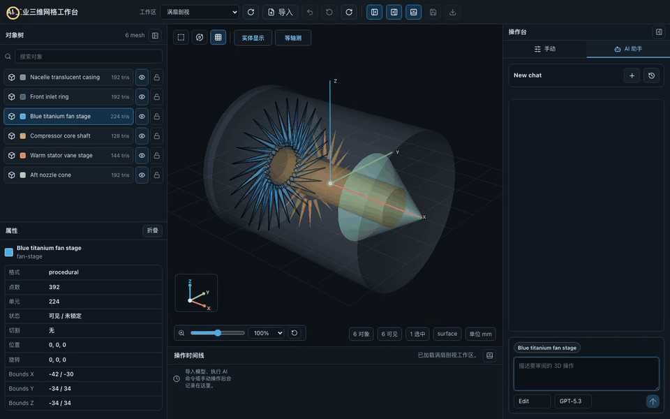
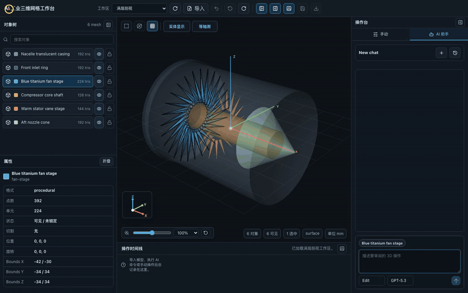
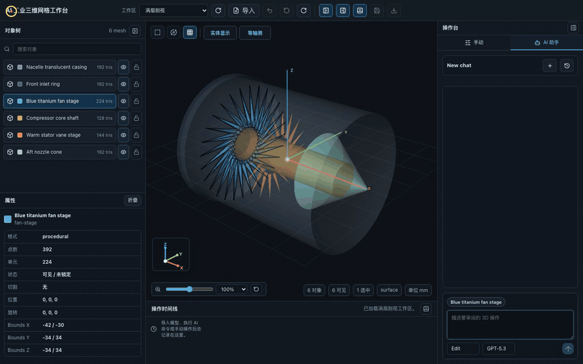

# AI 工业三维网格工作台 MVP

这是一个浏览器内运行的工业三维网格工作台原型，用 `vtk.js` 做三维渲染，用 React/TypeScript 做交互界面，并通过受控 action schema 演示自然语言驱动的三维操作。

## 快速运行

```bash
npm install
docker compose up --build -d agent-api
npm run dev
```

打开：`http://127.0.0.1:5173/`

`npm run dev` 默认通过 Vite proxy 把 `/api/agent/respond` 转发到本机 Docker 后端 `http://127.0.0.1:8787`。当前默认前端会调用这个本地 agent API；如果后端没有启动，AI 面板会显示请求错误。规则解析器仍作为离线 adapter 保留在代码中，主要用于开发和测试路径。

如需接入 Azure AI Foundry / AI Services，把 `.env.example` 复制为 `.env` 后设置：

```bash
AGENT_MODE=llm
LLM_PROVIDER=azure-ai-inference
LLM_BASE_URL=https://<resource-name>.cognitiveservices.azure.com
LLM_MODEL=<deployment-name>
LLM_API_KEY=<resource-key>
```

注意 `LLM_BASE_URL` 要使用 AI Services/Cognitive Services 的模型 endpoint，不要使用形如 `https://<resource>.services.ai.azure.com/api/projects/<project>` 的 Foundry project endpoint；后者通常面向 project/agent 管理 API，不适合作为 API key 的 chat completions base URL。

构建生产版本：

```bash
npm run build
```

运行测试：

```bash
npm test
```

后端 agent API 单独验证：

```bash
cd backend/agent-api
npm install
npm test
npm run check
```

浏览器烟测（需要本机 Chrome，默认检测 `http://127.0.0.1:4173/`）：

```bash
npm run preview -- --host 127.0.0.1
npm run smoke:browser
```

## 当前 MVP 能力

- 浏览器内 `vtk.js` 三维渲染工作台。
- 自动加载程序生成的涡扇发动机风格剖视模型，并可切换到机器人检测产线示例工作区。
- 支持导入本地 `.stl`、`.obj`、`.ply`、`.vtp` 文件。
- 左侧对象树、中央 3D 视窗、右侧属性/手动操作/AI 助手面板、底部操作时间线，并支持折叠和调整面板尺寸。
- 手动操作：对象树搜索、可见/锁定切换、视窗点选、显示模式、移动、绕 X/Y/Z 轴旋转、复制、可配置视觉切割预览/应用、适配视图、撤销/重做。
- AI 助手：支持 Ask / Edit / Agent 模式、历史会话、请求取消、结构化 JSON 调试，以及基于当前选择和历史的上下文请求。
- AI 操作：自然语言通过本地 `agent-api` 生成白名单 `AgentResponse` / `OperationCommand` 草稿，再由同一个 `OperationExecutor` 校验、预览、确认和执行；响应类型覆盖澄清、场景问答、单步操作草稿、多步操作计划、宏草稿和后端作业草稿。
- LLM 后端：`AGENT_MODE=mock` 默认不需要凭据；`AGENT_MODE=llm` 可接 OpenAI-compatible、Azure OpenAI 或 Azure AI Inference / AI Services endpoint。
- 后端作业边界：真实几何切割、网格划分、求解器和结果摘要目前只生成 `backendJobDraft` 草稿，不会启动 worker 或修改三维场景。

## 可演示的 AI 命令

```text
选择 nacelle
将选中对象沿 X 方向移动 20mm
把 nacelle 绕 Z 轴旋转 90 度
复制 stator 3 个，沿 X 方向间隔 10mm
沿 Z=0 平面切开全部可见对象，只保留正半边
这个场景里有哪些对象？
重置视角
```

AI 面板会先展示解析结果、风险提示和结构化 JSON。Edit 模式一次生成一个可审阅操作草稿；Agent 模式可返回多步计划或宏草稿。切割类操作进入预览/确认语义，不直接做不可逆几何修改；真实几何切割仍是增强版能力。

## 功能演示

GitHub README 不会在页面内直接播放仓库里的 `.mp4` 相对链接，因此这里使用 GIF 作为内联预览，并保留 MP4 作为高清录屏入口。

### AI 移动选中对象：沿 X 方向移动 20mm



[查看高清 MP4](artifacts/ai-workflow-recordings/01-move-selection-x-20mm.mp4)

### AI 旋转对象：将 nacelle 绕 Z 轴旋转 90 度



[查看高清 MP4](artifacts/ai-workflow-recordings/02-rotate-nacelle-z-90deg.mp4)

### AI 复制对象：复制 stator 并沿 X 方向间隔 10mm



[查看高清 MP4](artifacts/ai-workflow-recordings/03-clone-stator-x-10mm.mp4)

### AI 切割预览：沿 Z=0 平面保留正半空间


[查看高清 MP4](artifacts/ai-workflow-recordings/04-clip-all-z0-positive.mp4)

## 架构

```text
React Workbench UI
  -> AgentPanel / LlmAgentClient
  -> Local agent-api (/api/agent/respond)
  -> Mock or LLM provider
  -> validated AgentResponse / OperationCommand draft
  -> OperationExecutor
  -> SceneState / HistoryStore
  -> vtk.js Runtime
```

关键文件：

- `src/viewer/vtkRuntime.ts`：vtk.js runtime wrapper，管理 renderer、actor、mapper、camera、clipping plane。
- `src/viewer/sampleEngine.ts`：程序生成的涡扇发动机风格演示模型。
- `src/domain/actions.ts`：三维操作 action schema。
- `src/domain/protocol.ts`：AI 请求/响应协议，包括 action 草稿、计划、场景问答、宏草稿和后端作业草稿。
- `src/domain/executor.ts`：手动 UI 和 AI 命令共用的执行器。
- `src/agent/context.ts`：发送给 agent 的紧凑场景上下文，避免传递原始几何数据。
- `src/agent/adapters.ts`：前端 agent adapter，包括本地 API client 和离线规则解析器 adapter。
- `backend/agent-api/src/`：本地 agent API、mock agent、LLM provider client、schema 和服务端校验/归一化。
- `src/components/`：工作台 UI 组件。
- `scripts/smoke-browser.mjs`：用本机 Chrome DevTools 协议验证默认浏览器演示路径。

更完整的实现细节见：`docs/designs/agent-runtime-implementation.md`。

## 公开模型资源调研

默认示例模型采用程序生成，避免第三方授权和大文件体积风险。可以作为外部导入演示参考的公开资源：

- J57 turbojet Engine and stand：<https://www.printables.com/model/1582569-j57-turbojet-engine-and-stand/files>，STL，多部件，CC BY 4.0，主题贴合但体积较大。
- Turbofan engine model：<https://www.printables.com/model/567654-turbofan-engine-model/files>，STL，多部件，CC BY-SA 4.0，较轻量但需要注意 ShareAlike。
- Remix Motorized Jet engine Turbofan：<https://www.printables.com/model/859150-remix-motorized-jet-engine-turbofan>，STL，CC BY 4.0，适合作为备选外部样例。
- Impeller with Housing：<https://www.printables.com/model/647085-impeller-with-housing>，STL，CC BY-SA 4.0，适合叶轮/压缩机相关演示。
- NASA 3D Resources：<https://github.com/nasa/NASA-3D-Resources>，授权清楚，航空航天相关，但不是独立涡扇发动机结构。

如果要把第三方模型随项目分发，需要保留作者、许可证和来源链接；大 STL 建议先做减面或转换为浏览器更友好的格式。

## 后续增强方向

- 增加真实几何切割 job worker、截面曲线、VTU 非结构网格、标量场着色和 color map。
- 增加项目 JSON 保存/恢复、截图导出、网格导出。
- 大文件导入迁移到 Web Worker 或后端 VTK 转换服务。
